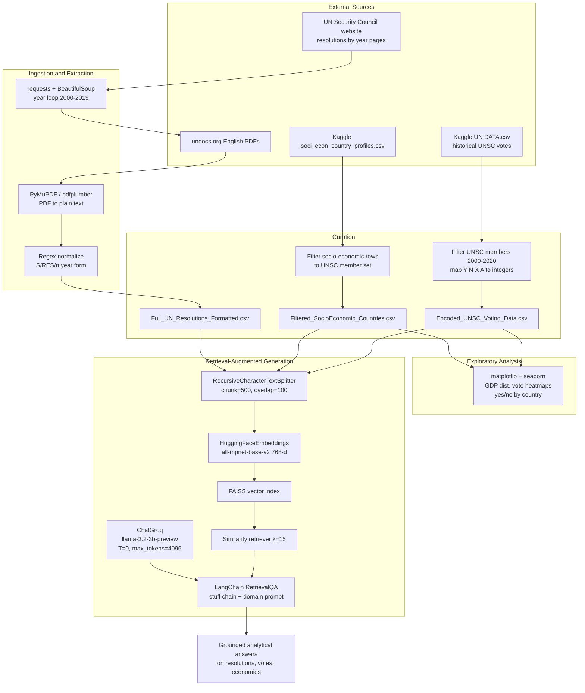
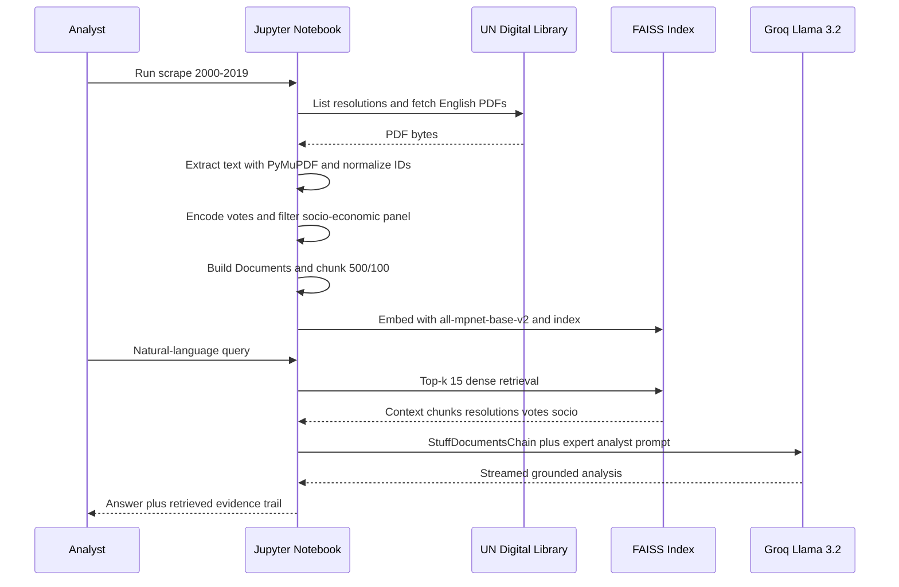

# UNSC Resolution Voting & Socio-Economic Analysis with RAG

End-to-end **social computing** pipeline that (1) scrapes United Nations Security Council (UNSC) resolution PDFs (2000–2019), (2) joins them with country-level socio-economic indicators and historical UNSC roll-call votes, (3) performs exploratory quantitative analysis of voting behavior, and (4) builds a **Retrieval-Augmented Generation (RAG)** system over the fused corpus using dense embeddings + FAISS + Llama 3.2 (Groq).

> Primary artifact: [`notebooks/social-computing-project.ipynb`](notebooks/social-computing-project.ipynb)  
> Project write-up: [`docs/project-report.pdf`](docs/project-report.pdf)

---

## Table of Contents

1. [Research Question](#research-question)
2. [Repository Layout](#repository-layout)
3. [System Architecture](#system-architecture)
4. [End-to-End Data / Inference Flow](#end-to-end-data--inference-flow)
5. [Datasets](#datasets)
6. [Quantified Metrics (from notebook + released CSVs)](#quantified-metrics-from-notebook--released-csvs)
7. [Methods & Tooling Map](#methods--tooling-map)
8. [Vote Encoding Schema](#vote-encoding-schema)
9. [RAG Configuration](#rag-configuration)
10. [Exploratory Analyses](#exploratory-analyses)
11. [Sample RAG Evaluations](#sample-rag-evaluations)
12. [Reproducibility](#reproducibility)
13. [Limitations](#limitations)
14. [License / Attribution](#license--attribution)

---

## Research Question

How do **UNSC member states’ voting patterns** over adopted resolutions (2000–2020) relate to their **socio-economic profiles**, and can a multimodal textual corpus (resolution body text + vote rolls + country indicators) support **grounded LLM analysis** via RAG?

The project treats resolutions as primary documents, votes as structured relational signals, and socio-economic variables as country-level covariates that can be retrieved jointly with geopolitical text.

---

## Repository Layout

```text
.
├── README.md
├── requirements.txt
├── .env.example
├── .gitignore
├── data/
│   ├── Encoded_UNSC_Voting_Data.csv      # roll-call votes, numeric encoding
│   └── Filtered_SocioEconomic_Countries.csv
├── docs/
│   └── project-report.pdf                # team project report
├── notebooks/
│   └── social-computing-project.ipynb    # full pipeline (Kaggle-oriented paths)
└── assets/                               # diagrams / figures (optional)
```

Large intermediate artifacts (raw resolution PDFs, `Full_UN_Resolutions*.csv`, FAISS indexes) are intentionally gitignored; regenerate them via the notebook.

---

## System Architecture



---

## End-to-End Data / Inference Flow



---

## Datasets

| ID | Role | Origin | Released in repo |
|----|------|--------|------------------|
| D1 | Resolution body text | Scraped UNSC English PDFs (2000–2019) via `https://main.un.org/securitycouncil/...` + undocs.org | Regenerated in notebook (`Full_UN_Resolutions_Formatted.csv`) |
| D2 | Socio-economic country profiles | Kaggle `soci_econ_country_profiles.csv` | [`data/Filtered_SocioEconomic_Countries.csv`](data/Filtered_SocioEconomic_Countries.csv) |
| D3 | Historical UNSC roll-call | Kaggle `UN DATA.csv` (Security Council rows) | [`data/Encoded_UNSC_Voting_Data.csv`](data/Encoded_UNSC_Voting_Data.csv) |

**Join keys**

- Resolutions ↔ votes: `ResolutionNumber` / `Resolution` in canonical form `S/RES/{id}({year})`
- Votes ↔ socio-economic: uppercase ISO-style country name matching (UNSC membership roster 2000–2020)

---

## Quantified Metrics (from notebook + released CSVs)

All figures below are measured from the committed artifacts and notebook cell outputs (Kaggle run).

### Corpus construction

| Metric | Value | Source |
|--------|------:|--------|
| Scrape window | Calendar years **2000–2019** (inclusive start, exclusive end at 2020) | Notebook scrape loop |
| Resolution PDFs processed | **1,217** | `Processing:` log lines in extraction cell |
| Resolutions with missing ID parse | **1** (`2019_2471(2019).pdf`) | Extraction warnings |
| Successful ID parse rate | **≈ 99.92%** (1216 / 1217) | Derived |
| RAG document chunks after splitting | **69,253** | Notebook: `Processed 69253 documents` |
| Text chunk size / overlap | **500 / 100** characters | `RecursiveCharacterTextSplitter` |
| Retrieval depth \(k\) | **15** chunks / query | `search_kwargs={"k": 15}` |
| Embedding model dimensionality | **768** (`all-mpnet-base-v2`) | Sentence-Transformers card |
| LLM generation budget | **4096** max tokens, temperature **0** | `ChatGroq` config |

### Encoded voting matrix (`Encoded_UNSC_Voting_Data.csv`)

| Metric | Value |
|--------|------:|
| Resolutions (rows) | **1,276** |
| Columns | **60** (`Resolution`, `Date`, + **58** member states present in this export) |
| Temporal coverage | **2000-01-13 → 2020-12-29** |
| Total country–resolution cells | **74,008** (= 1276 × 58) |
| Non-null recorded votes | **10,545** |
| Null / non-member cells | **63,463** |
| Matrix sparsity (null share) | **85.75%** |
| Share of cast votes that are **Yes (1)** | **98.63%** |
| Share **Abstain (0)** | **0.85%** |
| Share **No (−1)** | **0.08%** (8 recorded) |
| Share **Not present (−2)** | **0.44%** of cast (46) |

**Highest recorded affirmative vote counts (Yes = 1)**

| Country | Yes votes |
|---------|----------:|
| United Kingdom | 1,263 |
| Japan | 400 |
| Germany | 348 |
| South Africa | 341 |
| Argentina | 313 |
| Spain | 266 |
| Chile | 250 |
| Nigeria | 250 |
| Brazil | 248 |
| Peru | 246 |

> Interpretation: permanent members / frequent elected members dominate exposure; elected seats produce **sparse** columns by construction (membership is term-limited). Affirmative consensus on **adopted** resolutions is extremely high in this slice—consistent with UNSC practice where contested drafts often fail before adoption or via veto dynamics not fully captured as adopted “No” tallies.

### Socio-economic panel (`Filtered_SocioEconomic_Countries.csv`)

| Metric | Value |
|--------|------:|
| Countries retained | **40** UNSC-era members with profile coverage |
| Feature columns | **96** (region, demography, GDP structure, trade, HCI, QoL indexes, etc.) |
| GDP (million current US$) min / median / mean / max | **16,251 / 315,244 / 763,772 / 4,383,076** |
| Regional composition | SouthernEurope 6, NorthernEurope 6, EasternEurope 5, SouthAmerica 4, South-easternAsia 4, WesternEurope 4, + others |

**Top GDP (million current US$)** in the filtered panel: Japan (4.38M), Germany (3.36M), United Kingdom (2.86M), India (2.12M), Italy (1.82M).

### Raw vote table (pre-encoding, notebook)

| Metric | Value |
|--------|------:|
| Source table width | **270** columns (council metadata + historical member aliases) |
| Post-filter encoded width in full notebook run | up to **87** columns (`Resolution`, `Date`, + available roster matches) |
| Released CSV | curated **58**-country subset shipped under `data/` |

---

## Methods & Tooling Map

| Stage | Tool / Library | Where used |
|-------|----------------|------------|
| HTTP scrape | `requests` | Fetch yearly resolution index + English PDF URLs |
| HTML parse | `BeautifulSoup` (`bs4`) | Locate `/s/res/` links and `lang=en` PDF buttons |
| PDF text (probe) | `pdfplumber` | Spot-check extraction (e.g., S/RES/1367 (2001)) |
| PDF text (batch) | **PyMuPDF** (`fitz`) | Bulk extract `FullText` for all scraped PDFs |
| Tabular I/O | `pandas` | CSV load/save, filtering, encoding, document assembly |
| Regex ID normalize | `re` | Canonicalize `S/RES/{n}({yyyy})` |
| EDA plots | `matplotlib`, `seaborn` | GDP histogram/KDE, GDP–population scatter, top-10 GDP bars, vote-type bars, missingness heatmap, yes/no by country |
| Chunking | LangChain `RecursiveCharacterTextSplitter` | Character windows over resolutions / socio rows / vote rows |
| Embeddings | `sentence-transformers` via LangChain `HuggingFaceEmbeddings` | `sentence-transformers/all-mpnet-base-v2` |
| Vector DB | **FAISS** (`faiss-cpu`) through `langchain_community.vectorstores.FAISS` | Dense ANN index over 69,253 chunks |
| Orchestration | LangChain `RetrievalQA`, `PromptTemplate`, `Document` | Stuff-chain RAG with custom UNSC analyst prompt |
| Generator LLM | **Groq** `ChatGroq` → `llama-3.2-3b-preview` | Zero-temperature grounded generation |
| Secrets | `python-dotenv` / env var `GROQ_API_KEY` | Do **not** hardcode keys (notebook scrubbed) |
| Runtime | Kaggle Notebooks / local Jupyter | Original paths under `/kaggle/input` and `/kaggle/working` |

---

## Vote Encoding Schema

| Raw ballot | Encoded value | Semantics |
|------------|--------------:|-----------|
| `Y` | `1` | Affirmative |
| `N` | `-1` | Negative |
| `X` | `0` | Abstention |
| `A` | `-2` | Recorded as not present |
| `null` / absent from council that term | `NaN` (CSV empty) / mapped `-3` in notebook mapping dict for explicit missing | Non-membership or unavailable |

---

## RAG Configuration

```text
Documents  =  Resolution FullText
            ∪  "Socio-economic data for {country} includes: …"
            ∪  "Voting data for Resolution {id} on {date} includes: …"

Splitter   =  RecursiveCharacterTextSplitter(chunk_size=500, chunk_overlap=100)
Encoder    =  all-mpnet-base-v2 → 768-d L2-normalized embeddings (FAISS default)
Retriever  =  similarity, k=15
Chain      =  RetrievalQA, chain_type="stuff"
LLM        =  llama-3.2-3b-preview @ Groq, temperature=0, max_tokens=4096, streaming=True
```

**Prompt role:** “expert analyst of UN resolutions and voting patterns” — forces answers conditioned on retrieved context rather than parametric geopolitics alone.

**Chunk-scale implication:** 69,253 chunks implies a non-trivial index build cost (CPU FAISS + Sentence-Transformer forward passes). Retrieval returns ≤ 15 × ~500 chars ≈ **7.5k characters** of context before stuffing into the LLM (plus prompt overhead).

---

## Exploratory Analyses

Implemented in the notebook prior to RAG:

1. **GDP distribution** (histogram + KDE) over filtered UNSC-era economies  
2. **GDP vs population** scatter with country hue  
3. **Top-10 GDP** bar chart  
4. **Vote-type frequency** over the flattened encoded matrix  
5. **Missingness heatmap** (country × resolution) — visualizes elected-member sparsity  
6. **Positive vs negative vote totals** by country  

These establish that the voting tensor is **highly asymmetric** (near-universal Yes on adopted texts; sparse No/Abstain) and that socio-economic covariates are dense per country but **not** time-aligned to each resolution date (cross-sectional profiles).

---

## Sample RAG Evaluations

Qualitative probes executed in-notebook (answers are context-conditioned; lengths ≈ 3.6k–5.9k characters):

| Query theme | Observed retrieval behavior |
|-------------|-----------------------------|
| Somalia resolutions | Pulls Chapter VII / sanctions / AMISOM-era operative paragraphs (e.g., 1772, 1844, 1897, 1918 lineage) |
| India’s stance on sanctions | Mixes vote rows + sanctions-related resolution text |
| Russia & sanctions diplomacy | Retrieves DPRK/CAR/Abkhazia-adjacent operative language + veto/interest framing |
| Germany & EU economics | Surfaces Germany/Austria/Poland socio-economic feature dumps + Germany-mentioned operative clauses |
| USA military interventions | Retrieves conflict-prevention resolutions (e.g., S/RES/1366 framing) |
| Russia / Eastern Europe security | Retrieves Moscow Agreement / Abkhaz exercise language and regional security references |

This is a **demonstration evaluation**, not a scored RAG benchmark (no nDCG / faithfulness / citation-F1 suite was recorded in the notebook). The principal quantitative RAG metric available from the run is **index cardinality = 69,253 chunks** with **\(k=15\)** retrieval.

---

## Reproducibility

```bash
# 1. Clone
git clone https://github.com/chinmayirm/unsc-voting-socioeconomic-rag.git
cd unsc-voting-socioeconomic-rag

# 2. Environment
python3 -m venv .venv
source .venv/bin/activate
pip install -r requirements.txt

# 3. Secrets
cp .env.example .env
# set GROQ_API_KEY=...

# 4. Open notebook
jupyter notebook notebooks/social-computing-project.ipynb
```

**Path notes:** the notebook was authored on **Kaggle** (`/kaggle/input/un-analysis/...`, `/kaggle/working/...`). For local runs, point:

- `socio_economic_path` / `original_unsc_path` at your copies of the Kaggle inputs  
- resolution CSV paths at regenerated `Full_UN_Resolutions_Formatted.csv`  
- or directly at the released files under `data/` for the RAG assembly cells

**Expected heavy steps**

1. Multi-year PDF scrape (network bound)  
2. 1,217× PDF text extraction  
3. Embedding ~69k chunks (GPU recommended; CPU viable but slow)  
4. FAISS `from_documents` build  

---

## Limitations

- Adopted-resolution bias → **Yes-heavy** vote distribution; vetoed/failed drafts are underrepresented.  
- Socio-economic features are **cross-sectional**, not panel-aligned to each vote date.  
- Country-name string matching can drop P5/aliases if column headers diverge (hence width differences between full notebook encoding and the released CSV).  
- RAG uses **stuff** chain; long conflicting contexts may dilute faithfulness.  
- No automated retrieval/generation scorecard (BLEU/ROUGE/RAGAS) was logged.

---

## License / Attribution

- UNSC resolution texts © United Nations; reused here for academic analysis.  
- Socio-economic / UN voting CSVs originate from the Kaggle `un-analysis` bundle used in the notebook.  
- Code and documentation in this repository are provided for educational / research reproduction.

### Citation

If you use this repository, please cite the course project report in [`docs/project-report.pdf`](docs/project-report.pdf) and this GitHub repository.
